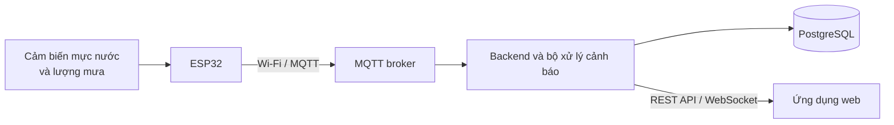

# IoT Flood Monitoring

Hệ thống IoT quan sát và cảnh báo sớm nguy cơ ngập cục bộ thông qua dữ liệu mực nước, lượng mưa và trạng thái của thiết bị đo.

Đây là đồ án tốt nghiệp của **Ngô Tuấn Hòa**, sinh viên Trường Công nghệ Thông tin và Truyền thông, Đại học Bách khoa Hà Nội.

## Mục tiêu

- Thu thập mực nước và lượng mưa từ nút cảm biến sử dụng ESP32.
- Truyền dữ liệu từ thiết bị về máy chủ qua Wi-Fi và MQTT.
- Lưu trữ dữ liệu đo để theo dõi theo thời gian thực và tra cứu lịch sử.
- Phát hiện các tình huống vượt ngưỡng, mực nước tăng nhanh, mất kết nối hoặc cảm biến bất thường.
- Hiển thị dữ liệu, trạng thái thiết bị và cảnh báo trên ứng dụng web.
- Đánh giá độ chính xác, độ trễ và độ ổn định bằng mô hình thử nghiệm.

## Kiến trúc tổng quan



Wi-Fi là phương thức truyền dữ liệu chính của phiên bản đầu tiên. LoRa được xem là phần mở rộng khi hệ thống cơ bản đã hoạt động ổn định.

Thiết kế chi tiết và các quyết định kỹ thuật được ghi tại [docs/architecture.md](docs/architecture.md).

## Công nghệ sử dụng

| Thành phần | Công nghệ |
| --- | --- |
| Nút cảm biến | ESP32, PlatformIO và Arduino framework |
| Cảm biến mực nước | Cảm biến siêu âm chống nước |
| Cảm biến lượng mưa | Cảm biến gầu lật |
| Truyền dữ liệu | Wi-Fi, MQTT |
| Backend | FastAPI, SQLAlchemy và Alembic |
| Cơ sở dữ liệu | PostgreSQL |
| Frontend | Vue 3, TypeScript và Vite |
| Cập nhật thời gian thực | WebSocket |
| MQTT broker | Eclipse Mosquitto |
| Môi trường triển khai | Docker Compose |

## Chức năng dự kiến

- Tiếp nhận và lưu dữ liệu đo từ thiết bị.
- Theo dõi mực nước và lượng mưa theo thời gian thực.
- Hiển thị biểu đồ lịch sử.
- Quản lý trạng thái hoạt động và lần kết nối gần nhất của thiết bị.
- Cảnh báo khi mực nước vượt ngưỡng hoặc tăng nhanh.
- Cảnh báo khi thiết bị mất kết nối hoặc dữ liệu cảm biến bất thường.
- Cấu hình ngưỡng cảnh báo.

## Cấu trúc repository

```text
iot-flood-monitoring/
├── firmware/       # Chương trình cho ESP32 và cảm biến
├── backend/        # MQTT consumer, API và xử lý cảnh báo
├── frontend/       # Giao diện web giám sát
├── hardware/       # Sơ đồ đấu nối và danh sách linh kiện
├── experiments/    # Kịch bản, dữ liệu và kết quả thử nghiệm
├── docs/           # Kiến trúc và tài liệu kỹ thuật
├── simulator/      # Bộ phát telemetry giả lập qua MQTT
├── compose.yaml
└── README.md
```

Các thư mục sẽ được tạo khi bắt đầu triển khai từng thành phần, tránh để lại các thư mục rỗng không có nội dung.

## Trạng thái

Dự án đang ở giai đoạn phát triển MVP. Mosquitto, PostgreSQL, telemetry simulator, backend FastAPI và frontend Vue đã chạy được bằng Docker Compose. Dashboard đã đọc số đo gần nhất và trạng thái thiết bị qua REST API. Bộ luật cảnh báo và WebSocket backend đã qua kiểm thử; firmware, biểu đồ, danh sách cảnh báo và WebSocket frontend chưa được triển khai.

## Chạy hạ tầng cục bộ

Yêu cầu: Docker Desktop đang chạy ở chế độ Linux containers.

```powershell
if (-not (Test-Path .env)) { Copy-Item .env.example .env }
docker compose up -d
docker compose ps
```

Nếu cổng MQTT mặc định `1883` đã được ứng dụng khác sử dụng, sửa `MQTT_HOST_PORT` trong `.env`, ví dụ `MQTT_HOST_PORT=1884`. Cổng mà ESP32 sử dụng là cổng host này; các container vẫn gọi Mosquitto bằng `mqtt:1883`.

Kiểm tra PostgreSQL và luồng publish/subscribe của Mosquitto:

```powershell
.\scripts\infra-smoke-test.ps1
```

Xem log hoặc dừng hạ tầng:

```powershell
docker compose logs -f
docker compose down
```

Volume Docker giữ dữ liệu khi container được tạo lại. Chỉ dùng `docker compose down -v` khi chủ động muốn xóa toàn bộ dữ liệu PostgreSQL và MQTT.

Mosquitto hiện cho phép kết nối không cần tài khoản để phát triển trong mạng LAN tin cậy. Không mở cổng `1883` trên router và không triển khai cấu hình này trực tiếp lên Internet. Trước khi chạy thử ngoài hiện trường, cần bật tài khoản, TLS và giới hạn firewall.

Khi ESP32 và máy tính dùng cùng Wi-Fi, MQTT host trong firmware là địa chỉ IPv4 LAN của máy tính, không phải `localhost`. Backend chạy trong Compose sẽ dùng hostname `mqtt`; database dùng hostname `db`.

## Chạy telemetry simulator

Simulator giúp phát triển backend khi chưa có ESP32 hoặc cảm biến. Lệnh sau gửi 5 bản tin bình thường rồi dừng:

```powershell
docker compose --profile simulator run --rm `
  -e SIMULATOR_MESSAGE_COUNT=5 `
  -e PUBLISH_INTERVAL_SECONDS=1 `
  simulator
```

Các kịch bản hiện có là `normal`, `heavy-rain`, `flood`, `sensor-error` và `offline`. Hướng dẫn đầy đủ nằm tại [simulator/README.md](simulator/README.md).

## Chạy backend

Backend tự chạy Alembic migration, subscribe MQTT và mở REST API tại `http://localhost:8000`:

```powershell
docker compose up -d --build backend
docker compose ps
Invoke-RestMethod http://localhost:8000/health
```

Sau khi backend healthy, kiểm tra toàn bộ luồng REST và WebSocket bằng Python trên Windows, Linux hoặc macOS:

```bash
python scripts/smoke_test.py
```

Swagger UI nằm tại `http://localhost:8000/docs`. Chi tiết endpoint và cách chạy xem tại [backend/README.md](backend/README.md).

## Chạy frontend

```powershell
docker compose up -d --build frontend
```

Mở `http://localhost:5173`. Container Nginx phục vụ bản production build và chuyển tiếp `/api/`, `/ws` tới backend. Dashboard mặc định đọc `node-001`; dùng ô mã thiết bị để đổi trạm và nút **Cập nhật** để lấy số đo mới. Khi simulator dừng và gửi trạng thái offline, dashboard vẫn hiển thị mẫu gần nhất kèm chú thích offline.

## Tài liệu

- [Kiến trúc hệ thống](docs/architecture.md)
- [Kế hoạch và tiến độ thực tế](docs/plan.md)
- [Dự án và mã nguồn tham khảo](docs/references.md)
- [Quyết định lựa chọn công nghệ](docs/decisions/0001-technology-stack.md)

## Tác giả

Ngô Tuấn Hòa — MSSV 20225189
