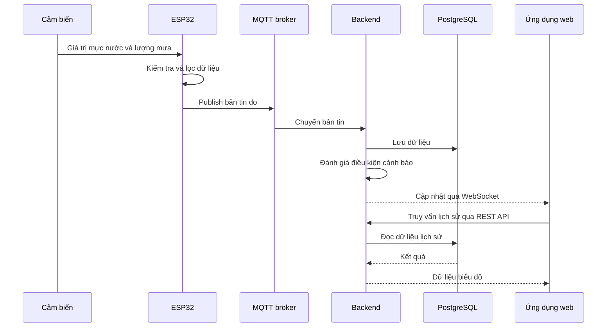
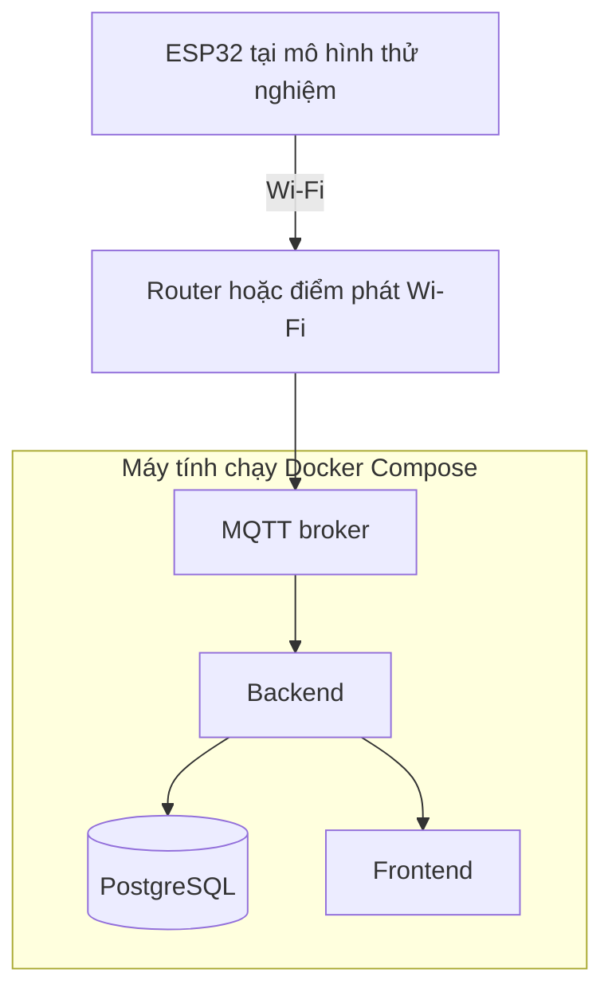
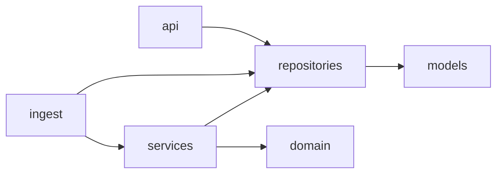

# Kiến trúc hệ thống

Tài liệu này mô tả kiến trúc hiện tại của hệ thống IoT quan sát và cảnh báo sớm nguy cơ ngập cục bộ. Kiến trúc được cập nhật theo mã nguồn và sẽ tiếp tục thay đổi khi prototype phần cứng được kiểm chứng.

## 1. Phạm vi phiên bản đầu tiên

Phiên bản đầu tiên gồm một nút ESP32, một cảm biến mực nước, một cảm biến lượng mưa, một máy chủ và một ứng dụng web. Thiết bị truyền dữ liệu qua Wi-Fi. LoRa, nhiều điểm đo và các kênh gửi thông báo bên ngoài chưa thuộc phạm vi bắt buộc.

## 2. Các thành phần

| Thành phần | Trách nhiệm |
| --- | --- |
| Nút cảm biến | Đọc cảm biến, lọc dữ liệu cơ bản, tạo bản tin và theo dõi tình trạng thiết bị |
| MQTT broker | Trung chuyển bản tin giữa thiết bị và backend |
| Backend | Xác thực thiết bị, kiểm tra dữ liệu, lưu trữ, đánh giá cảnh báo và cung cấp API |
| PostgreSQL | Lưu thiết bị, dữ liệu đo, cấu hình ngưỡng và lịch sử cảnh báo |
| Ứng dụng web | Hiển thị dữ liệu hiện tại, lịch sử, trạng thái thiết bị và cảnh báo |

## 3. Luồng dữ liệu



## 4. Hợp đồng MQTT phiên bản 1

Quy ước topic ban đầu:

```text
flood-monitoring/devices/{device_id}/telemetry
flood-monitoring/devices/{device_id}/status
flood-monitoring/devices/{device_id}/commands
```

Payload telemetry:

```json
{
  "schema_version": 1,
  "device_id": "node-001",
  "timestamp": "2026-10-08T14:00:00Z",
  "sequence": 1,
  "water_level_cm": 18.4,
  "rainfall_mm": 2.8,
  "signal_strength_dbm": -61,
  "sensor_status": "normal"
}
```

Quy ước trường:

- `timestamp` là thời điểm lấy mẫu theo UTC, định dạng ISO 8601.
- `sequence` tăng dần sau mỗi lần thiết bị khởi động. Backend dùng bộ ba `device_id`, `sequence` và `timestamp` để phát hiện bản tin lặp; cách nhận diện phiên khởi động riêng sẽ được bổ sung nếu phần cứng cho thấy cần thiết.
- `water_level_cm` là mực nước theo centimet. Giá trị có thể là `null` khi cảm biến lỗi, khi đó `sensor_status` phải là `error`.
- `rainfall_mm` là lượng mưa đo được trong chu kỳ lấy mẫu hiện tại, tính bằng milimet.
- `signal_strength_dbm` là RSSI Wi-Fi theo dBm.

Payload trạng thái:

```json
{
  "schema_version": 1,
  "device_id": "node-001",
  "timestamp": "2026-10-08T14:00:00Z",
  "connectivity": "online"
}
```

Telemetry và trạng thái dùng QoS 1. Telemetry không retain; trạng thái retain để consumer mới biết trạng thái gần nhất. Thiết bị cấu hình Last Will là `offline` trên topic trạng thái. Topic `commands` được dành cho giai đoạn sau và chưa có hợp đồng payload.

## 5. Mô hình dữ liệu PostgreSQL

- `devices`: trạng thái kết nối, trạng thái cảm biến và lần nhìn thấy cuối.
- `telemetry`: số đo, timestamp thiết bị, timestamp server nhận và khóa chống trùng.
- `thresholds`: ngưỡng mực nước, tốc độ tăng và lượng mưa theo từng thiết bị.
- `alerts`: loại, mức độ, nội dung, thời điểm bắt đầu/kết thúc/xác nhận.

Schema được quản lý bằng Alembic. Migration đầu tiên tạo đủ bốn bảng; bộ luật cảnh báo và API đọc/cập nhật threshold đã được triển khai.

## 6. Cảnh báo dự kiến

- Mực nước vượt ngưỡng cấu hình.
- Tốc độ tăng mực nước vượt ngưỡng trong một khoảng thời gian.
- Lượng mưa vượt ngưỡng theo cửa sổ thời gian.
- Thiết bị không gửi heartbeat đúng hạn.
- Giá trị cảm biến nằm ngoài phạm vi hợp lệ hoặc thay đổi bất thường.

Mỗi cảnh báo cần lưu thời điểm bắt đầu, mức độ, nguyên nhân, thiết bị liên quan và thời điểm kết thúc hoặc được xác nhận.

## 7. Triển khai phiên bản thử nghiệm



Máy tính cá nhân có thể chạy toàn bộ dịch vụ trong giai đoạn phát triển và trình diễn. Hệ thống chưa cần Raspberry Pi hoặc máy chủ riêng.

## 8. Công nghệ đã chốt

| Thành phần | Lựa chọn |
| --- | --- |
| Firmware | PlatformIO với Arduino framework |
| MQTT broker | Eclipse Mosquitto |
| Backend | FastAPI |
| ORM và migration | SQLAlchemy và Alembic |
| Database | PostgreSQL |
| Frontend | Vue 3, TypeScript và Vite |
| Quản lý trạng thái frontend | Pinia |
| Gọi REST API | Axios |
| Biểu đồ | Apache ECharts |
| Cập nhật thời gian thực | WebSocket |
| Môi trường chạy cục bộ | Docker Compose |

Lý do và hệ quả của lựa chọn được ghi tại [ADR-0001](decisions/0001-technology-stack.md).

## 9. Kiến trúc mã nguồn

### 9.1. Backend

```text
backend/
├── app/
│   ├── api/                 # REST/WebSocket route, HTTP validation và response
│   ├── domain/              # Quy tắc nghiệp vụ thuần, không phụ thuộc database
│   ├── repositories/        # Truy vấn và ghi dữ liệu SQLAlchemy
│   ├── services/            # Điều phối domain với repository
│   ├── main.py              # Application factory và vòng đời ứng dụng
│   ├── ingest.py            # Điều phối một bản tin MQTT đã nhận
│   ├── mqtt_consumer.py     # Kết nối/subscription Mosquitto
│   ├── realtime.py          # Hub WebSocket và tạo realtime event
│   ├── topics.py            # Hợp đồng và parser MQTT topic
│   ├── models.py            # SQLAlchemy models
│   └── schemas.py           # Pydantic request/payload/response models
├── alembic/                 # Database migration
├── scripts/                 # Công cụ chạy thủ công trong container
└── tests/                   # Unit và integration test tự động
```

Hướng phụ thuộc chính:



`domain/alert_rules.py` chỉ nhận giá trị đầu vào và trả về quyết định cảnh báo, không mở session hoặc ghi database. Vì vậy các ngưỡng, mức độ và tốc độ tăng có thể được unit test độc lập. `repositories/` chịu trách nhiệm truy cập dữ liệu; `services/` chuyển dữ liệu persistence thành kiểu domain và áp dụng kết quả.

Paho MQTT chạy network loop ở thread riêng. Sau khi `ingest_message` commit thành công, callback gọi `RealtimeHub.publish_from_thread`. Hub dùng `asyncio.run_coroutine_threadsafe` để chuyển việc broadcast sang đúng event loop của FastAPI; code trong thread MQTT không thao tác trực tiếp với WebSocket. Cách này phù hợp MVP một process. Nếu tải tăng hoặc triển khai nhiều backend instance, ranh giới này nên được thay bằng hàng đợi/broker sự kiện.

### 9.2. Frontend

```text
frontend/src/
├── api/monitoring.ts        # Axios client: device và latest telemetry
├── composables/useReadings.ts # Trạng thái REST và vòng đời request
├── components/             # Thành phần trình bày tái sử dụng
│   ├── AlertList.vue
│   ├── DeviceStatus.vue
│   ├── MetricCard.vue
│   └── WaterLevelChart.vue
├── types/monitoring.ts      # Kiểu dữ liệu dùng chung của dashboard
├── views/DashboardView.vue # Ghép các vùng của màn hình dashboard
├── App.vue                  # Root component tối giản
├── main.ts
└── style.css
```

`DashboardView` sử dụng `useReadings` để tải device và latest telemetry song song qua Axios. Request có timeout 10 giây và được hủy khi đổi thiết bị hoặc tháo component, tránh dữ liệu cũ ghi đè thiết bị đang chọn. Component trình bày nhận dữ liệu qua props, không gọi mạng trực tiếp.

Mã thiết bị mặc định là `node-001`, có thể chọn qua form hoặc query `device_id`. Số đo hiển thị theo đơn vị cm/mm; thời gian UTC từ backend được định dạng theo giờ Việt Nam. Backend 404 được ánh xạ thành trạng thái chưa có dữ liệu; lỗi mạng/API có thông báo riêng và nút thử lại. Mực nước `null` không được quy đổi thành 0. Khi thiết bị offline, số đo gần nhất được giữ để tra cứu và có chú thích rõ.

Nginx (Docker) và Vite proxy (development) chuyển `/api` tới backend cùng origin. Frontend hiện cập nhật bằng REST khi mở trang, đổi thiết bị hoặc bấm **Cập nhật**. Kết nối WebSocket sẽ đặt trong composable riêng ở FE-007; danh sách cảnh báo và biểu đồ lịch sử đang là placeholder.

Dashboard dùng nền phẳng, thanh điều khiển 48px ở desktop, dải trạng thái mẫu đo và một khung ba ô chỉ số. Phần dưới chia biểu đồ/cảnh báo theo tỷ lệ 2:1, chuyển thành một cột ở mobile. Thời gian lấy mẫu hiển thị tương đối và có giờ tuyệt đối khi hover; nhãn tương đối được tính lại khi giao diện render do cập nhật dữ liệu, không có timer riêng. Số liệu offline hiển thị màu xám. Đường cảnh báo/nguy hiểm trong biểu đồ trống chỉ minh họa bố cục, chưa đại diện cho ngưỡng cấu hình thật.

### 9.3. Kiểm thử và vận hành cục bộ

- `scripts/smoke_test.py` chạy đa nền tảng, kiểm tra luồng simulator → MQTT → backend → PostgreSQL → REST/WebSocket.
- `backend/scripts/websocket_probe.py` là client kiểm tra thủ công được đóng trong image backend, không nằm lẫn với test discovery.
- Mỗi service có `.dockerignore`; Docker Compose là điểm vào chung cho môi trường phát triển.

## 10. Quyết định còn mở

- Cảm biến mực nước cụ thể và phương pháp hiệu chuẩn.
- Cảm biến lượng mưa mua sẵn hay gầu lật tự chế.
- Cách xác thực thiết bị và quản lý thông tin bí mật.
- Chu kỳ gửi dữ liệu, heartbeat và thời gian xác định mất kết nối.
- Ngưỡng cùng mức độ cảnh báo dựa trên kết quả thử nghiệm.

Các quyết định quan trọng nên được ghi lại trong thư mục `docs/decisions/` dưới dạng ADR khi dự án bắt đầu có nhiều phương án và thay đổi kiến trúc.
